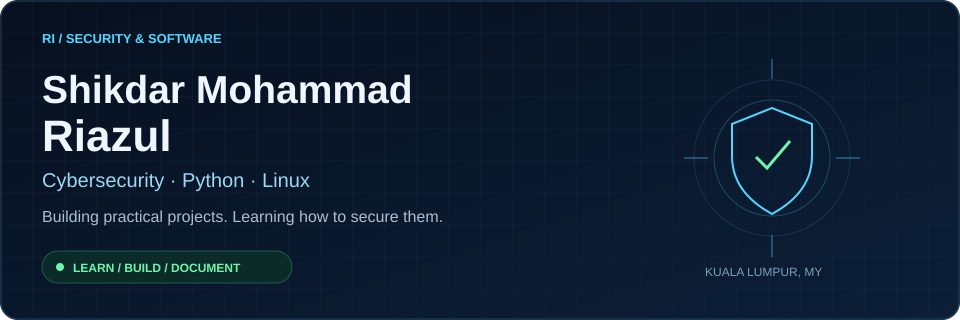
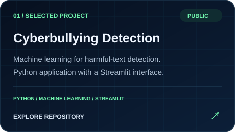
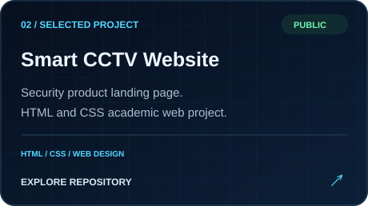

  

  <a href="#selected-public-work">Selected work</a> &nbsp; / &nbsp;
  <a href="#skills--practice">Skills &amp; practice</a> &nbsp; / &nbsp;
  <a href="#project-notebook">Project notebook</a>

## Security starts with understanding systems.

I'm **Riazul**, based in **Kuala Lumpur, Malaysia**. I build Python projects and explore cybersecurity through Linux and networking practice. My interests connect **safer online experiences**, **security awareness**, and **practical system fundamentals**.

This profile brings together my public code and the projects I have yet to publish. I'm developing my skills through building, experimenting, and documenting what I learn.

## Selected public work

<table>
<tr>
<td width="50%" valign="top">

<a href="https://github.com/smriazul2002-ux/cyberbullying-app"><strong>View cyberbullying-app →</strong></a>

Exploring automated detection of harmful online text, connecting text classification with online safety.

</td>
<td width="50%" valign="top">

<a href="https://github.com/smriazul2002-ux/smart-cctv-website"><strong>View smart-cctv-website →</strong></a>

An HTML and CSS landing page presenting a smart surveillance concept, built for an academic assignment.

</td>
</tr>
</table>

<strong>More public repositories · cyberbullying project family</strong>

Related repositories are grouped here as part of the same project area:

- [cyberbullying-backend](https://github.com/smriazul2002-ux/cyberbullying-backend) — Python repository.
- [cyberbullying-backend-v2](https://github.com/smriazul2002-ux/cyberbullying-backend-v2) — Jupyter Notebook repository.
- [Name-cyberbullying-app-Public-](https://github.com/smriazul2002-ux/Name-cyberbullying-app-Public-) — described as a TF-IDF and Logistic Regression detection app with Streamlit.

## Skills & practice

| Area | Current grounding |
| :--- | :--- |
| **Python** | Public cyberbullying application and related Python repositories. |
| **Machine learning applications** | Harmful-text classification project; Streamlit interface and related notebook work. |
| **HTML & CSS** | Public Smart CCTV landing page built for an academic assignment. |
| **Linux** | Kali Linux and Ubuntu practice; lab notes are not yet published here. |
| **Networking & security** | Practicing TCP/IP, DNS, SSH, Nmap and Wireshark in learning labs; public write-ups to follow. |

**Learning direction:** network security, web application security, Python security tooling, and clear technical documentation.

## Project notebook

The following projects and labs are part of my learning work. **Their code or write-ups are not yet published on this public profile.** Implementation details and completion status will be documented when uploaded.

| Project / lab | Focus | Public availability |
| :--- | :--- | :--- |
| **Python Security Awareness Game** | Interactive security awareness learning | Not yet uploaded |
| **Phishing Detection** | Exploring phishing identification | Not yet uploaded |
| **Kali / Ubuntu Networking Labs** | Linux networking and security practice | Write-ups not yet uploaded |

### Next documentation goals

- Publish setup instructions, screenshots, and a short walkthrough for each project.
- Explain detection methods, evaluation approach, and limitations where applicable.
- Share reproducible lab notes with the environment, commands, observations, and lessons learned.

---

  <strong>Understand the system. Build with care. Keep learning.</strong> 
  Security practice belongs in owned environments and explicitly authorized labs.

