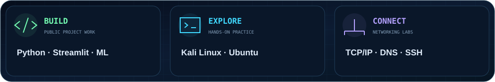
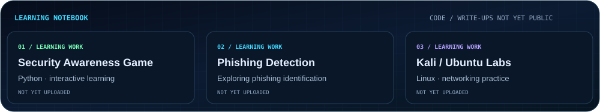

  

  <a href="#about">ABOUT</a> &nbsp; ✦ &nbsp;
  <a href="#selected-work">SELECTED WORK</a> &nbsp; ✦ &nbsp;
  <a href="#toolkit--practice">TOOLKIT</a> &nbsp; ✦ &nbsp;
  <a href="#learning-notebook">LEARNING LAB</a>

## About

I'm **Shikdar Mohammad Riazul**, exploring the intersection of **cybersecurity, Python, and Linux**. I build projects around safer online experiences and develop my understanding of systems through networking practice.

**My approach:** understand the fundamentals, build something useful, and document the lessons.

  

## Selected work

Two public projects, connecting online safety with security-focused web design.

  
  

  <a href="https://github.com/smriazul2002-ux/cyberbullying-app">Cyberbullying Detection ↗</a> &nbsp; / &nbsp;
  <a href="https://github.com/smriazul2002-ux/smart-cctv-website">Smart CCTV Website ↗</a>

<strong>Explore the cyberbullying project family</strong>

These public repositories belong to the same project area:

- [cyberbullying-backend](https://github.com/smriazul2002-ux/cyberbullying-backend) — Python repository.
- [cyberbullying-backend-v2](https://github.com/smriazul2002-ux/cyberbullying-backend-v2) — Jupyter Notebook repository.
- [Name-cyberbullying-app-Public-](https://github.com/smriazul2002-ux/Name-cyberbullying-app-Public-) — described as a TF-IDF and Logistic Regression detection app with Streamlit.

## Toolkit & practice

**Building with** &nbsp; `Python` · `Streamlit` · `Machine Learning` · `HTML` · `CSS`

**Practicing in labs** &nbsp; `Kali Linux` · `Ubuntu` · `TCP/IP` · `DNS` · `SSH` · `Nmap` · `Wireshark`

<strong>How these skills connect to my work</strong>

| Area | Current grounding |
| :--- | :--- |
| Python & machine learning applications | Public cyberbullying application and related Python / notebook repositories. |
| HTML & CSS | Smart CCTV academic landing page. |
| Linux & networking | Kali / Ubuntu learning labs; public write-ups are not yet uploaded. |

My learning interests include network security, web application security, and Python security tooling.

## Learning notebook

Projects and labs I have yet to publish. **Code / write-ups are not yet uploaded**, and completion status will be documented when they are published.

  

<strong>What I want to document next</strong>

- **Security Awareness Game:** publish the code, setup steps, and a short walkthrough.
- **Phishing Detection:** explain the method, evaluation approach, and limitations alongside the implementation.
- **Linux & networking labs:** share the environment, commands, observations, and lessons learned.

Security practice belongs in owned environments and explicitly authorized labs.

 

  

